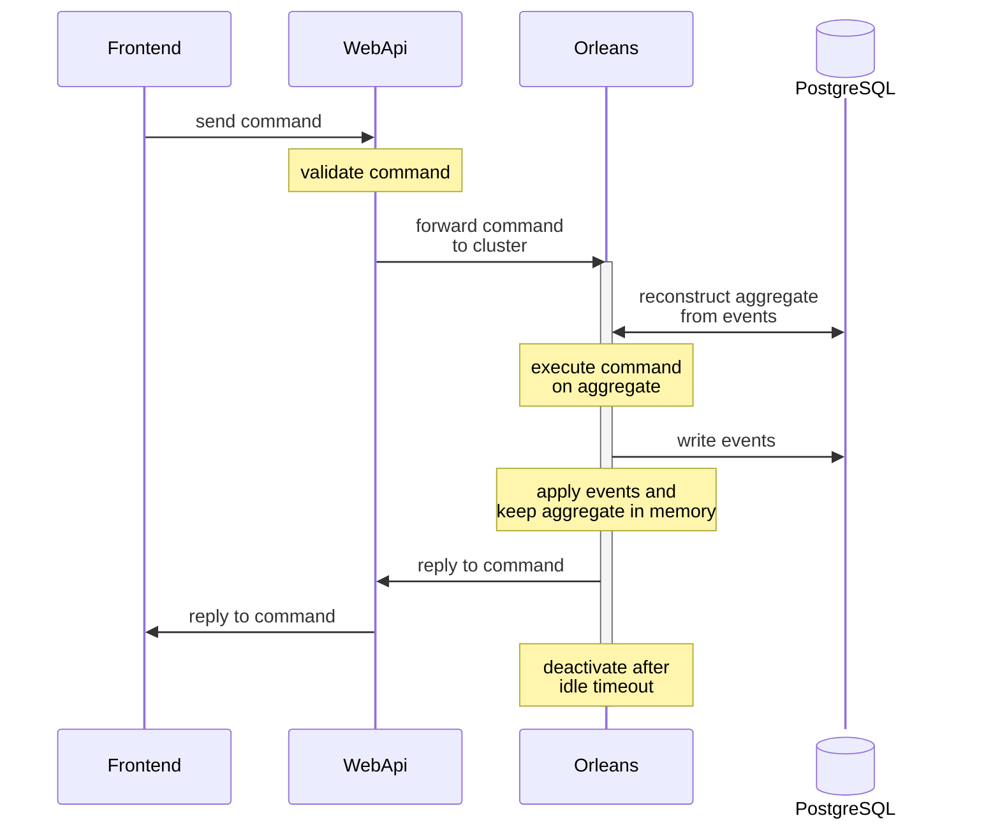
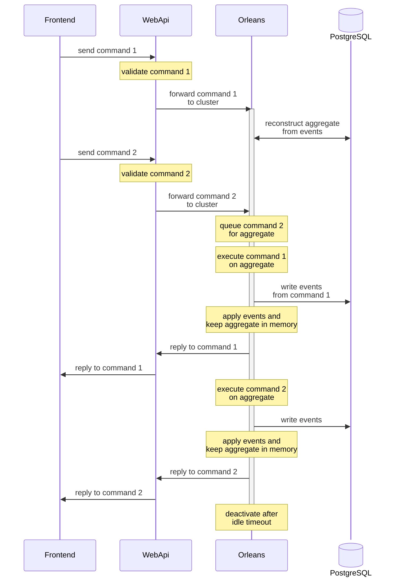
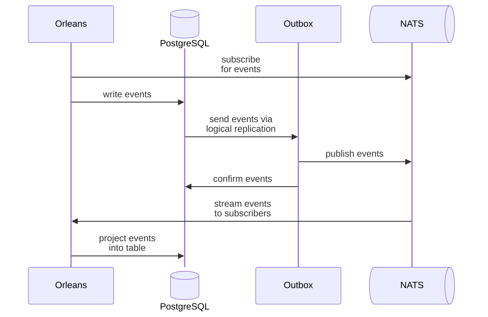
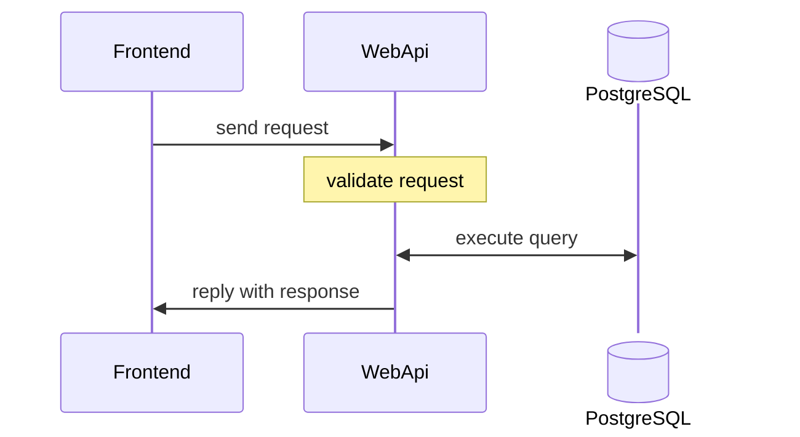
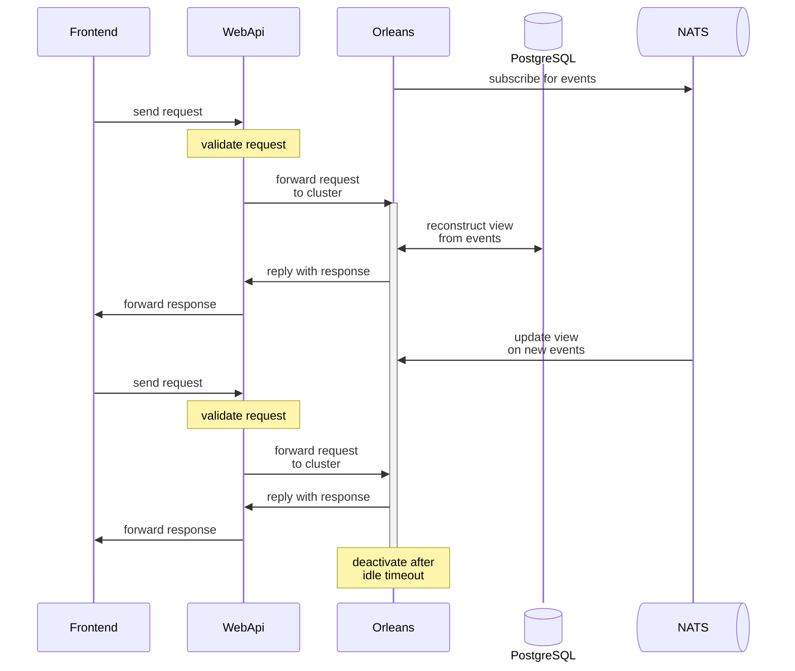

# Implementing Event Sourcing and CQRS

> **Disclaimer:**  
> "Cogito ergo sum" - "I think, therefore I am"  
> Or as I put it: _"I think, therefore I have opinions"_  
> In this repository you will find **my** opinions on how to implement event sourcing and CQRS,
> "ports & adapters", project structure and various different things.
> It is ok, that your opinions differ.
> Neither of us may be "right" - whatever "being right" actually means. 🤷  
> What we might agree on: context matters
>
> And I won't go into the details of the different technologies used here.
> I assume you basically know enough about all this.
> If not, there are tons of resources out there to all of these topics.

This is an experimental playground to explore the possibilities within my requirements.

- **On-Premise:** No "cloud only" features like Azure Tables etc.
- **Cheap:** Low/no license costs
- **Scalable:** If really needed - not "globally with millions of concurrent users", but maybe to hundreds or even a thousand users.

## Why Microsoft Orleans?

- Grains are single-threaded (non-reentrant)  
  ➡️ Queuing of commands sent to aggregates
- Grains are kept in memory for some time  
  ➡️ Caching of active aggregates/projections
- Streaming  
  ➡️ Easy notifications of events  
  ➡️ Abstract integration with different message brokers
- Extensible providers for storage/streaming  
  ➡️ Integration with custom storage/message broker

...and I always wanted to try this, so why not? 🤷

## Why PostgreSQL?

Almost every application needs to store data.
There are a lot of different kinds of storage, like filesystems, relational databases, NoSQL databases etc..
Some of them are "cloud only" like Azure Tables, others may need complex setup and configuration.

PostgreSQL is a mature relational database with some interesting features.
It can be easily installed locally, run as a container or purchased as a managed service.

And it has this feature of "logical replication" which I always wanted to try using it as an outbox.
Because with every kind of "event store" you are really interested in having some kind of outbox to publish these events for consumers like projections.
Please read [this post by Oskar Dudycz](https://event-driven.io/en/push_based_outbox_pattern_with_postgres_logical_replication/) for more information.

## Why NATS/Garnet/Entity Framework Core/ASP.NET Core/Angular?

"Well, actually" these don't matter.

Orleans needs some kind of storage for making its clustering work.
And you should separate that from your grains' storage.
In this repository I use Garnet as a Redis replacement for that.
But you can use whatever you need - even "localhost clustering" works.

Speaking of "grain storage", since there's already a PostgreSQL database involved, I just use the Ado.Net storage provider of Orleans.
But as Orleans is highly configurable, use what _you_ need.

For accessing a database there are a lot tools out there.
You can write raw SQL or use some kind of helper like Dapper.
I chose Entity Framework Core, because I know how to use that.
And it's "batteries included" when it comes to managing migrations.
Finally this repository is not about how to store data.
If your projections have to fulfill different needs, use the right tool for the job.

Additionally for Orleans Streams you need some kind of backbone.
NATS seems cool and there's some built-in provider for that.

An application is useless if it doesn't provide some kind of API.
The most used one is some kind of HTTP/JSON API.
I know how to use ASP.NET Core and it integrates very well with Orleans.

Handcrafting HTTP requests with curl or http-files is a good point to start.
But in the end you want some kind of frontend, which is accessable.
Angular is the framework where I'm comfortable with.

## Execute Command

- Frontend sends a command to the WebApi
- After validating the command the WebApi forwards it to the Orleans cluster
- Orleans activates the aggregate grain and restores its state from the event store (PostgreSQL)
- The aggregate handles the command and returns the created events
- Orleans stores the events in the event store and apply them to the aggregate (in memory)
- Success is reported back to the WebApi and Frontend
- After a timeout Orleans deactivates the aggregate grain and releases its resources

## Execute Commands In Parallel

While Orleans is executing a command on a aggregate grain, incoming additional commands are queued in the inbox of the grain.
Only after finishing the first command, the next command will be executed.
Since the aggregate stays in memory, restoring from the event store is not needed.

## Persistent Projections

AKA "persisted views"

- Orleans stores the event in the event store (PostgreSQL)
- PostgreSQL publishes the event with its logical replication feature
- The Outbox is listening on its replication slot and publishes the events on a message queue (NATS)
- NATS is forwarding the events back into the Orleans cluster
- Orleans activates a projection grain which updates the corresponding row in a database table
- The projection grains stays in memory, speeding up the updates
- Multiple events are processed in order one at the time (like command queuing)
- After a timeout Orleans deactivates the projection grain and releases its resources

### Query Persisted Views

- Frontend sends a query to the WebApi
- After validating the request the WebApi executes the query against the database
- The response is sent back to the Frontend

### Rebuild Persistent Projections

If you have to change the logic of your persisted projection (adding/remove fields, interpret events in a different way),
you have the problem, that you have a database full of data, that's not conforming to the new kind of projection.

But event sourcing has you covered!
You can "just" delete all of the projected data and rebuild the database with replaying all the events that are important to the projection.
Doing this manually can be tedious.

// TODO provide an easy "rebuild projection" integration

## Ad-hoc Projections

You don't always need to persist a projection to some database.
If your stream is not that long (and it shouldn't be very long, otherwise "you're holding it wrong") you can just read the events from the event store and project them in-memory.
The advantage is, that you are always free to adjust the logic of your projection.
Just redeploy your application and you will have a fresh view on the world of your data.

And this is where the lifecycle of Orleans grains seems like a perfect fit.
If you call a grain and it's not activated yet, Orleans will do that for you.
On activation the grain can read state, like building up the projection in-memory.
Additionally it can explicitly subscribe to the stream of the events it is interested in.
It will receive updates automatically and can apply them to the in-memory projection.
If the API calls this grain again while it's been active, it can just return the data.
It's (more or less) guaranteed to be up-to-date.
As up-to-date as eventually consistency is.

### Query In-Memory Views

- Frontend sends a query to the WebApi
- After validating the request the WebApi forwards it to the Orleans cluster
- Orleans activates the view grain and restores its state from the event store (PostgreSQL)
- The view grain subscribes for updates on this view on the message queue
- The response is sent back to the WebApi and Frontend
- While the view grain is activated it updates itself in memory
- The next request can be answered directly from memory, speeding up the response time
- After a timeout Orleans deactivates the view grain and releases its resources

