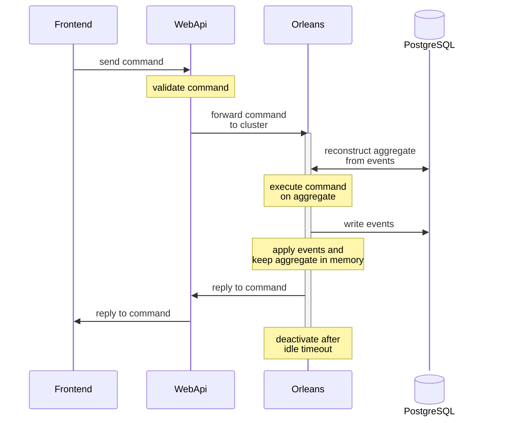
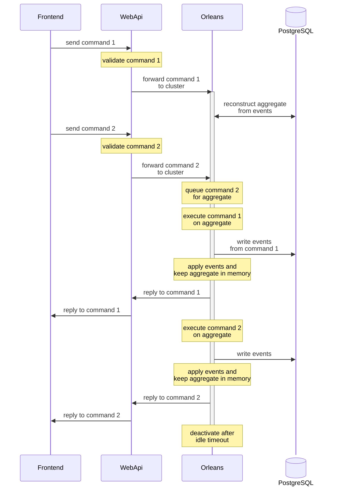
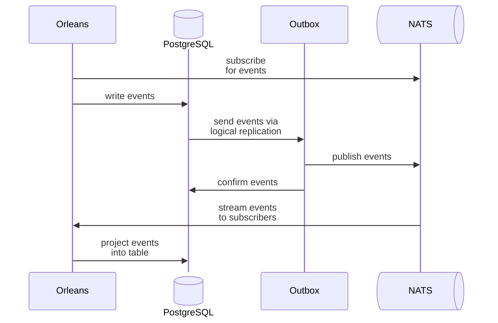
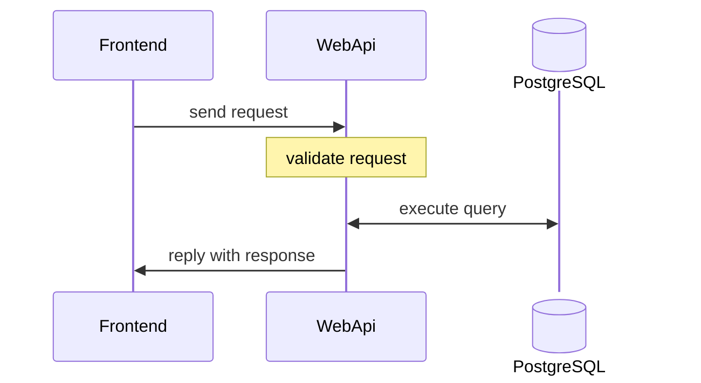
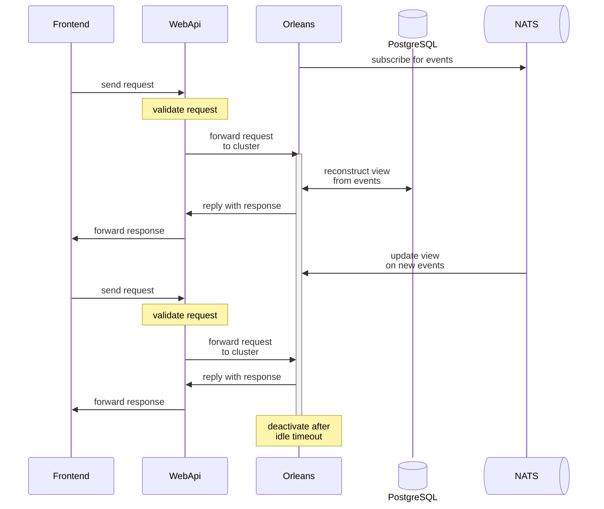

# Implementing Event Sourcing and CQRS with Microsoft Orleans

This is an experimental playground to explore the possibilities within my requirements.

- **On-Premise:** No "cloud only" features like Azure Tables etc.
- **Cheap:** Low license costs, therefore PostgreSQL as a storage provider
- **Scalable:** If really needed

## Why Orleans?

Grains are single-threaded (non-reentrant)  
=> Queuing of commands sent to aggregates

Grains are kept in memory for some time  
=> Caching of active aggregates/projections

Streaming  
=> Easy In-Memory notifications  
=> Abstract integration with different message brokers

Extensible providers for storage/streaming  
=> Integration with custom storage/message broker

...and I always wanted to try this, so why not? 🤷

## Execute Command

- Frontend sends a command to the WebApi
- After validating the command the WebApi forwards it to the Orleans cluster
- Orleans activates the aggregate grain and restores its state from the event store (PostgreSQL)
- The aggregate handles the command and returns the created events
- Orleans stores the events in the event store and apply them to the aggregate (in memory)
- Success is reported back to the WebApi and Frontend
- After a timeout Orleans deactivates the aggregate grain and releases its resources

## Execute Commands In Parallel

While Orleans is executing a command on a aggregate grain, incoming additional commands are queued in the inbox of the grain.
Only after finishing the first command, the next command will be executed.
Since the aggregate stays in memory, restoring from the event store is not needed.

## Persistent Event Projection

- Orleans stores the event in the event store (PostgreSQL)
- PostgreSQL publishes the event with its logical replication feature
- The Outbox is listening on its replication slot and publishes the events on a message queue (NATS)
- NATS is forwarding the events back into the Orleans cluster
- Orleans activates a projection grain which updates the corresponding row in a database table
- The projection grains stays in memory, speeding up the updates
- Multiple events are processed in order one at the time (like command queuing)
- After a timeout Orleans deactivates the projection grain and releases its resources

## Query Persisted Views

- Frontend sends a query to the WebApi
- After validating the request the WebApi executes the query against the database
- The response is sent back to the Frontend

## Query In-Memory Views

- Frontend sends a query to the WebApi
- After validating the request the WebApi forwards it to the Orleans cluster
- Orleans activates the view grain and restores its state from the event store (PostgreSQL)
- The view grain subscribes for updates on this view on the message queue
- The response is sent back to the WebApi and Frontend
- While the view grain is activated it updates itself in memory
- The next request can be answered directly from memory, speeding up the response time
- After a timeout Orleans deactivates the view grain and releases its resources

