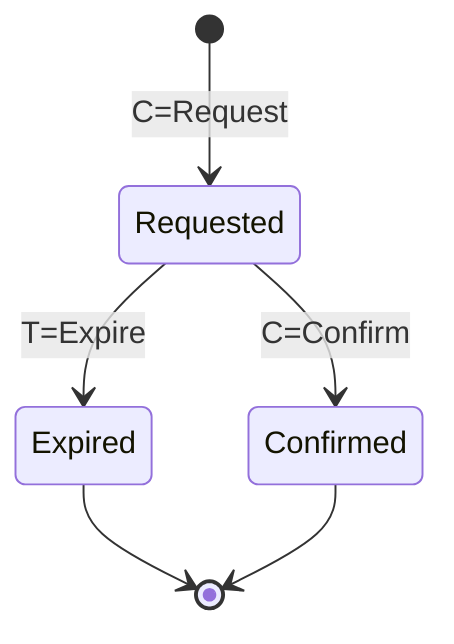

# DRAFT: Identity

A collection of unsorted thoughts about identity and authentication management.

## About

Management of `VerificationCode`s, `EmailAddress`es, `User`s, `Tenant`s and their `Role`s in each tenant.

## Definitions

Abbrevations

- C = Command
- Q = Query
- E = Event
- T = Timer (command)
- A = Action/Sideeffect
- S = State/Status
- R = Result/Response
- "Version 0" = aggregate does not exist yet

Names of commands, events, queries, roles etc. are "namespaced" with the name of the module and entity/aggregate.
Example: `Identity.User.Registered`

"Obvious" parts of the names are omitted in this document for brevity.

## Workflows

### Sign Up/In/Off

The user starts the registration or sign-in process with providing an email-address.
The system sends a verification code to this address.
The app navigates to a form for entering the email-address, verification code and (if not yet registered) a "display-name" for the user.
If the reservation/sign-in is not confirmed within the expiration timeout, it gets automatically marked as "expired".
Sending the correct verification code within the expiration timeout transitions the email-address to "confirmed".
While not confirmed a new verification code can be requested overwriting the previous one.

- C: `Auth.SignIn` (returns `Register`/`SignIn`)
  - C: `EmailAddress.Register`
    - R: `Confirmed`
      - C: `VerificationCode.Request` // TODO define `SignIn` source
  - A: Send verification code
- C: `Auth.ConfirmRegistration`
  - C: `EmailAddress.ConfirmRegistration`
  - A: Send auth-cookie
- C: `Auth.ConfirmSignIn`
  - C: `VerificationCode.Confirm`
  - A: Send auth-cookie
- C: `Auth.SignOff`
  - A: Delete auth-cookie

### Register E-mail Address

Returns: `UserId`, `Registered` with `VerificationCode` or `Confirmed`

- C: `EmailAddress.Register`
  - S: "Version 0", `Closed`
    - C: `User.Reserve` (create user-id)
    - GOTO `Registered`
  - S: `Registered`
    - C: `VerificationCode.Request` // TODO define `Register` source
    - E: `EmailAddress.Registered`
  - S: `Confirmed`
    - OK

### Confirm E-mail Address Registration

- C: `EmailAddress.ConfirmRegistration`
  - S: `Registered`
    - C: `VerificationCode.Confirm`
    - E: `EmailAddress.RegistrationConfirmed`

TODO how/when execute `User.Register`?

## `Role`

### Description

Roles are statically defined by the application per module.
They have a name, an optional `TenantId` and an optional (string) value.
They should be stored as claims in the auth-token.
The name and the tenant-id can be interpreted as the claim-type, and the value as the claim-value.

### Identity-Roles

- Roles belonging to the (physical) system (no claim-value)
  - `Identity.System.Operator`
  - `Identity.System.Manager`? (with limited permissions)
- Roles belonging to a tenant (claim-value is `TenantId`)
  - `Identity.Tenant.Owner`
  - `Identity.Tenant.Admin`
  - `Identity.Tenant.Manager`?
  - `Identity.Tenant.Member`

## `VerificationCode`

### Description

Verification codes guard actions like signing in.
They are sent via email to the user.
After confirming a code for a given action it will transition to "confirmed".
If a verfication code is not confirmed within the expiration timeout it will transition to "expired".
Once a verfication code is "confirmed" or has "expired" it cannot be reused.

Each verification code is associated with a "source".
When confirming a verfication code the correct source must be provided.
The message sent along with the code can be derived from the source.

TODO Start async workflow on `Confirmed` derived from `Source`?

### State Transitions

### Events

- `Requested`
  - `VerificationCode`
  - `RequestedAt`
  - `RequestedByUserId`
  - `EmailAddress`
  - `Source`
- `Confirmed`
  - `VerificationCode`
  - `ConfirmedAt`
  - `ConfirmedByUserId`
- `Expired`
  - `VerificationCode`
  - `ExpiredAt`
  - `ExpiredByUserId`
- `Revoked`
  - `VerificationCode`
  - `RevokedAt`
  - `RevokedByUserId`

### Commands

- `Request`
  - `EmailAddress`
  - `Source`
- `Confirm`
  - `VerificationCode`
  - `Source`
- `Expire`
  - `VerificationCode`
- `Revoke`
  - `VerificationCode`

## `EmailAddress`

### Description

E-mail addresses are key to the identity management.
They are essentially the "username".

- They have to be unique and there cannot be a user without an e-mail address.
- A user can have multiple e-mail addresses.
- They are used to invite users to the platform.

So there has to be a "source of truth" for them.

- The e-mail-address is normalized (e.g. similar to Microsoft.AspNetCore.Identity with `string.Normalize().ToLowerInvariant()`).
- There can be multiple invitations in parallel for different tenants.
- A new invitation for a tenant overwrites the previous one and invalidates the verification code and role.
- Invitations expire after a timeout.
- Registrations and invitations can run in parallel.
- Accepted invitations also confirm ongoing registrations.
- Confirming a registration doesn't accept invitations.
- After closing an e-mail address it can be registered/invited for a new user with a new user-id.
- If in the "closed" state it can be restored for the current user.

### Events

Reservation:

- `Registered`
  - `NormalizedEmailAddress`
  - `EmailAddress`
  - `RegisteredAt`
  - `ForUserId`
  - `VerificationCode`
- `RegistrationConfirmed`
  - `NormalizedEmailAddress`
  - `ConfirmedAt`
  - `VerificationCode`
  - `UserDisplayName`
- `RegistrationExpired`
  - `NormalizedEmailAddress`
  - `ExpiredAt`
  - `VerificationCode`

Invitation:

- `InvitationSubmitted`
  - `NormalizedEmailAddress`
  - `EmailAddress`
  - `SubmittedAt`
  - `SubmittedByUserId`
  - `ForUserId`
  - `VerificationCode`
  - `TenantId`
  - `Role`
- `InvitationRevoked`
  - `NormalizedEmailAddress`
  - `RevokedAt`
  - `RevokedByUserId`
  - `TenantId`
- `InvitationAccpeted`
  - `NormalizedEmailAddress`
  - `AcceptedAt`
  - `AcceptedByUserId`
  - `VerificationCode`
- `InvitationExpired`
  - `NormalizedEmailAddress`
  - `ExpiredAt`
  - `VerificationCode`

Other:

- `Closed`
  - `NormalizedEmailAddress`
  - `ClosedAt`
  - `ClosedByUserId`
- `Restored`
  - `NormalizedEmailAddress`
  - `RestoredAt`
  - `RestoredByUserId`

## `User`

### Description

- Signing in can be done via "code by email" (later with passkey).
- For each sign-in a unique `SessionId` is generated and stored in the auth token.
- Accessing with an auth-token containing a "signed-out" session-id needs reauthentication.
- Each user has one role per invited tenant.
- Profile (with avatar/picture)?

### Events

- `Reserved`
  - `UserId`
  - `ReservedAt`
  - `EmailAddress`
- `Registered`
  - `UserId`
  - `RegisteredAt`
  - `EmailAddress`
  - `DisplayName`
- `DisplayNameChanged`
  - `UserId`
  - `ChangedAt`
  - `ChangedByUserId`
  - `DisplayName`
- `EmailAddressChangeConfirmationSent`
  - `UserId`
  - `SentAt`
  - `SentByUserId`
  - `NewEmailAddress`
  - `VerificationCode`
- `EmailAddressChangeConfirmed`
  - `UserId`
  - `ComfirmedAt`
  - `VerificationCode`
- `EmailAddressChangeExpired`
  - `UserId`
  - `ExpiredAt`
  - `VerificationCode`
- `SignInCodeSent`
  - `UserId`
  - `SentAt`
  - `EmailAddress`
  - `VerificationCode`
- `SignInCodeConfirmed`
  - `UserId`
  - `ComfirmedAt`
  - `VerificationCode`
  - `SessionId`
  - `RemoteInfo`? (like IP address?)
- `SignInCodeExpired`
  - `UserId`
  - `ExpiredAt`
  - `VerificationCode`
- `SignedOut`
  - `UserId`
  - `SignedOutAt`
  - `SignedOutByUserId`
  - `SessionId`
- `MembershipStarted`
  - `UserId`
  - `StartedAt`
  - `StartedByUserId`
  - `TenantId`
  - `Role`
- `RoleChanged`
  - `UserId`
  - `ChangedAt`
  - `ChangedByUserId`
  - `TenantId`
  - `Role`
- `MembershipSuspended`
  - `UserId`
  - `SuspendedAt`
  - `SuspendedByUserId`
  - `TenantId`
- `MembershipResumed`
  - `UserId`
  - `ResumedAt`
  - `ResumedByUserId`
  - `TenantId`
- `MembershipRevoked`
  - `UserId`
  - `RevokedAt`
  - `RevokedByUserId`
  - `TenantId`

Later:

- `PasskeyAdded`
  - `UserId`
  - `AddedAt`
  - `AddedByUserId`
  - `CredentialId`
  - `Data` (will be `Microsoft.AspNetCore.Identity.IdentityPasskeyData`)
- `PasskeyUpdated`
  - `UserId`
  - `UpdatedAt`
  - `UpdatedByUserId`
  - `CredentialId`
  - `Data` (will be `Microsoft.AspNetCore.Identity.IdentityPasskeyData`)
- `PasskeyRemoved`
  - `UserId`
  - `RemovedAt`
  - `RemovedByUserId`
  - `CredentialId`
- `PasskeySignedIn`
  - `UserId`
  - `SignedInAt`
  - `CredentialId`
  - `Data`? (what is needed?)
  - `SessionId`
  - `RemoteInfo`? (like IP address?)

## `Tenant`

### Description

A tenant is a logical unit of users who belong together like an "organization" or "workspace".

- Tenants are registered by users.
- Tenants have to be activated, e.g. by payment or "demo".
- Activations expire automatically and must be renewed.
- Logo?
- Profile?

### Events

- `Registered`
  - `TenantId`
  - `RegisteredAt`
  - `RegisteredByUserId`
  - `DisplayName`
- `DisplayNameChanged`
  - `TenantId`
  - `ChangedAt`
  - `ChangedByUserId`
  - `DisplayName`
- `Activated`
  - `TenantId`
  - `ActivatedAt`
  - `ActivatedByUserId`
  - `ActivationExpiresAt`
- `Deactivated`
  - `TenantId`
  - `DeactivatedAt`
  - `DeactivatedByUserId`
- `Terminated`
  - `TenantId`
  - `TerminatedAt`
  - `TerminatedByUserId`
