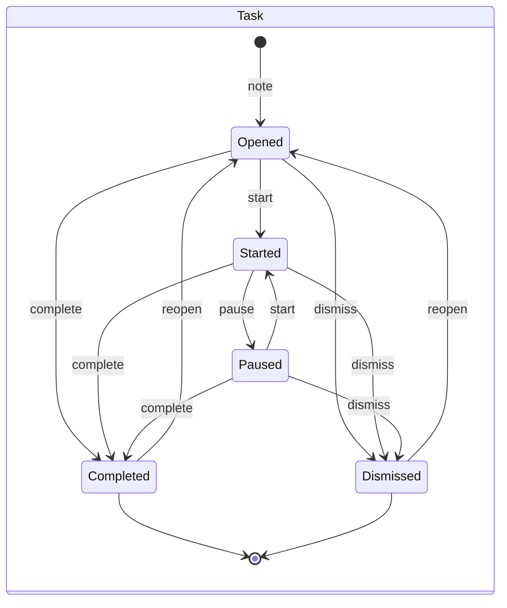

# The ToDo Feature Module

The main purpose of this feature module is to show case the Event-Sourcing framework.
We all know to-do lists to some extend, so I don't have to explain a lot.
And it can be complex enough to have room for "fancy stuff".

The ToDo module manages "tasks" and their transitions between different states like "opened" up to "completed".

In the future there may be "boards" and "teams" for more advanced visualization.

## The Domain

A task has a simple title, which describes the task to do.

A task can be in one of the following states:

- `Opened`: this is the "to do" state
- `Started`: someone started the work on this task ("doing")
- `Paused`: the work is paused (still "doing")
- `Completed`: the work is "done"
- `Dismissed`: a decision was made to not do the work ("don't")

